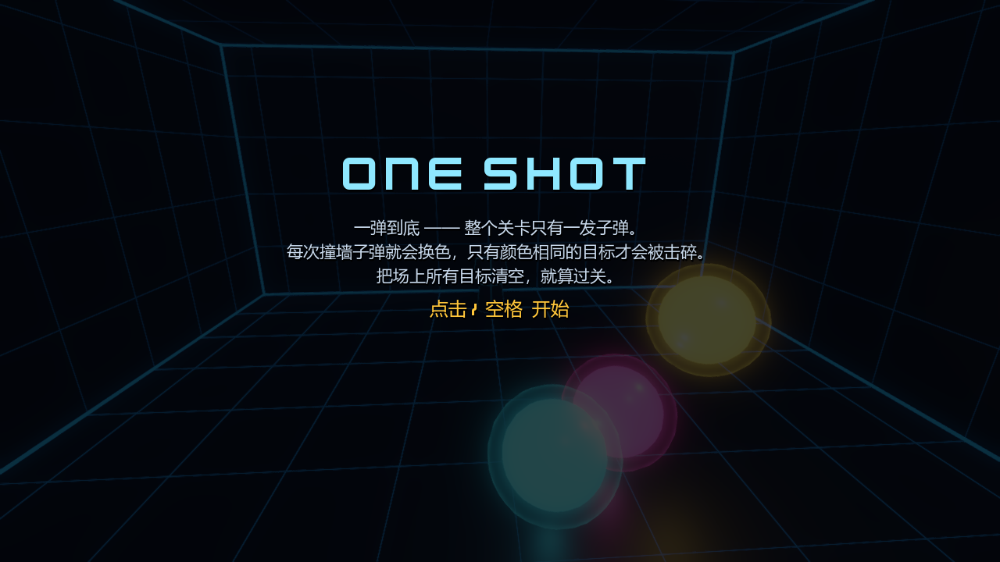
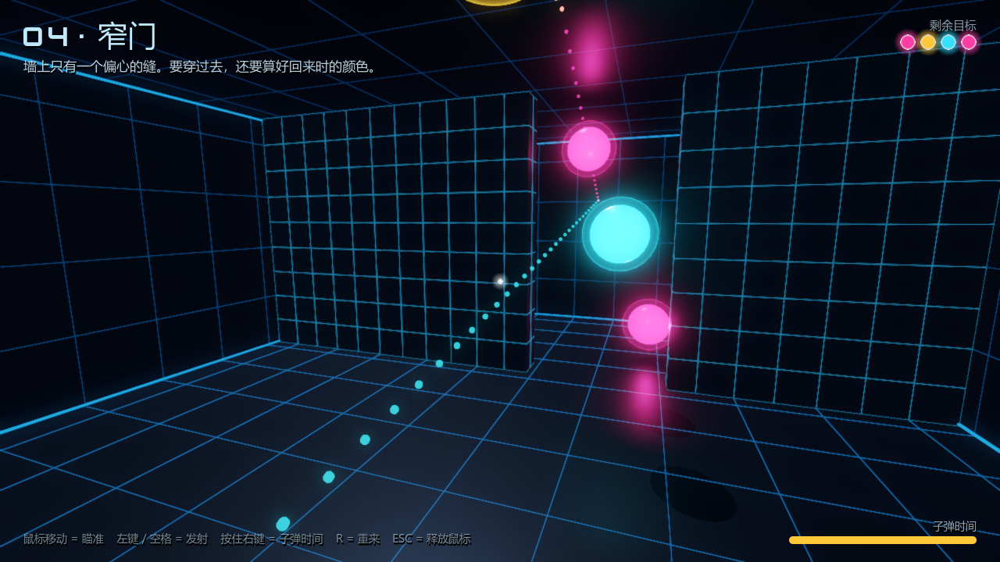
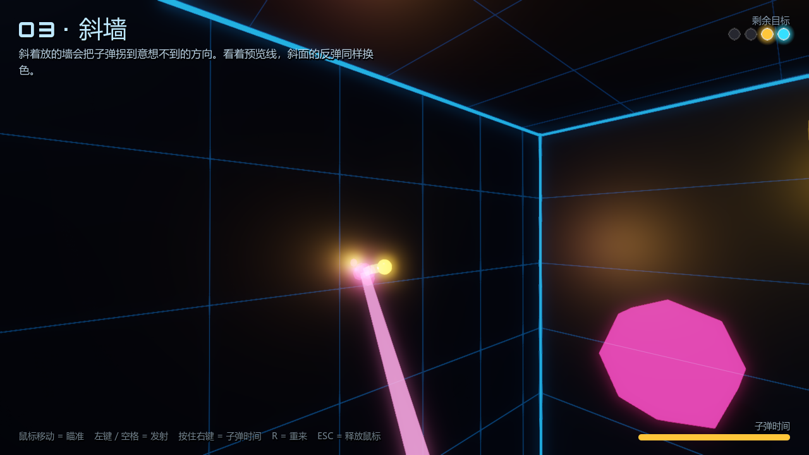

# ONE SHOT · 一弹到底

> **作者：王越豪（湖南科技大学）**
> 个人学习作品，仅供学习、研究与交流使用。转载请保留署名。

一个用 **Godot 4.6** 做的简易 3D 弹球解谜射击小游戏。体量很小（工程 + 素材一共几 MB），
但玩法有自己的一套：**整个关卡只有一发子弹，而且子弹每撞一次墙就会变色。**

> 借鉴的成熟玩法：Ricochet Kills / 台球库边反弹 / Angry Birds 式弹道预览 / 子弹时间。
> 新奇点：**反弹换色** —— 子弹颜色按 青 → 品红 → 琥珀 循环，只有颜色一致的目标会被击碎，
> 而且会**直接穿过去**；撞到颜色不对的目标则当作撞墙处理（同样换色）。
> 于是"往哪儿弹"变成了"按什么顺序、带着什么颜色去弹"。





---

## 玩法规则

1. 每关固定一门炮，鼠标瞄准，**只发一颗**子弹。
2. 子弹碰到墙壁 / 平台 / 颜色不对的目标 → 反射 + **换色**（青 → 品红 → 琥珀 → 青）+ 掉能量。
3. 碰到**颜色相同**的目标 → 击碎，并**直接穿过去**（不换色、不掉速）。所以一条直线能串掉一串同色目标。
4. 每撞一次速度乘 0.79，速度掉到阈值以下子弹就"能量耗尽"，飞行结束。
5. 场上目标全部清空即过关；否则按 `R` 重来。

## 操作

| 操作 | 键 |
| --- | --- |
| 瞄准 | 移动鼠标（按住 `Ctrl` 精瞄）/ 方向键 |
| 发射 | 鼠标左键 / `空格` |
| 子弹时间 | 按住鼠标右键（每关 3 秒） |
| 重来 | `R` |
| 释放 / 重新捕获鼠标 | `ESC` / 点击画面 |

关卡的**虚线预览**只画前 4 段（3 次反弹），后面要靠自己想——
而虚线里每一段的颜色，就是子弹飞过那一段时的真实颜色，可以直接拿来排颜色顺序。

## 运行

需要 Godot 4.6（标准版即可）。

```bash
# 直接跑
godot --path .

# 或者用编辑器打开这个文件夹后按 F5
```

## 工程结构

```
project.godot          Godot 工程配置
scenes/main.tscn       唯一场景（一个挂着 game.gd 的 Node3D 根节点）
shaders/               程序化着色器：网格金属、轨迹带、目标光环（不依赖任何贴图）
scripts/
  ballistics.gd        ★ 纯数学弹道核心（射线 vs OBB/球体、反射、换色、能量）
  levels.gd            6 关的纯数据（场地尺寸、方块、炮位、目标球）
  arena.gd             按关卡数据搭出 3D 场景（墙/方块/目标/炮台/道具）
  game.gd              状态机、瞄准、相机、飞行演出、特效
  hud.gd               代码搭的 UI（Kenney Future + 系统中文字体回退）
  audio.gd             音效池 + 混响总线
  materials.gd         材质工厂
tools/
  solve.gd             关卡工具：扫描可解性 / 找弹道 / 自动摆目标 / 量宽容度
  verify.gd            端到端验收：用标准解法把 6 关在真实游戏里各打一遍
  shot.gd              开发用截图工具
  fetch_assets.ps1     重新下载 CC0 素材
assets/                字体 / 音效 / 模型（全部 CC0，见下）
screenshots/           运行截图
```

### 为什么弹道要自己写

预览虚线、子弹真实飞行、离线求解器**共用 `ballistics.gd` 里的同一份 `simulate()`**，
所以"预览显示能中"和"实际结果"逐位一致，玩家不会被手感骗到；
射线求交也天然不会出现高速穿透（tunneling）。
另外墙角处一次命中会同时贴住两个面，代码里对**所有接触面法线依次反射**并做"脱嵌"，
否则子弹会沿着错误法线穿出竞技场（这个 bug 在开发时真的出现过，`tools` 里的扫描工具发现的）。

### 关卡是怎么保证一定能过的

没有手搓坐标硬猜，而是"**先找弹道、再摆目标**"：

1. `solve.gd cand` 扫描所有发射角，挑出几何形状漂亮的弹道（要求前几段够长、方向有变化）；
2. `solve.gd autogen` 沿着选中的弹道，在每一段的中点上摆一个**该段颜色**的目标，
   每摆一个就重算一次，只有"同一发角度依然能清场"才保留；
3. `solve.gd scan` 用 1° 网格全角度扫描，确认每一关都存在解法；
4. `solve.gd fine` 用 0.1° 细扫量出解法的**宽容度**：

```
[0] 01 · 反射入门  0.1° 细扫: 可解 35/6561  yaw 2.3~5.0 (2.7°)  pitch -5.0~-2.2 (2.8°)
[1] 02 · 绕柱      0.1° 细扫: 可解 507/6561 yaw 7.8~10.2 (2.4°) pitch 10.5~13.2 (2.7°)
[2] 03 · 斜墙      0.1° 细扫: 可解 60/6561  yaw 1.0~3.0 (2.0°)  pitch 11.4~13.4 (2.0°)
[3] 04 · 窄门      0.1° 细扫: 可解 145/6561 yaw -3.6~-2.4 (1.2°) pitch 11.4~12.6 (1.2°)
[4] 05 · 高低台    0.1° 细扫: 可解 423/6480 yaw 9.9~12.1 (2.2°) pitch 15.9~18.1 (2.2°)
[5] 06 · 终局      0.1° 细扫: 可解 190/6400 yaw -25.9~-24.1 (1.8°) pitch 15.1~16.6 (1.5°)
```

也就是说每关的瞄准窗口都有 1.2°~2.8°，配合虚线预览是很宽松的。

### 验收

```bash
# 每关都用标准解法在真实游戏里打一遍，全部通关才算过
godot --path . --script res://tools/verify.gd
```

当前结果：`通过 6 / 6`（第 6 关触发 FINISH 结算画面）。

---

## 素材来源

全部是 **CC0 / 公共领域** 素材，来自 [Kenney.nl](https://kenney.nl)（下载脚本：`tools/fetch_assets.ps1`，
源为 GitHub 上的完整镜像 [ETdoFresh/kenney.nl](https://github.com/ETdoFresh/kenney.nl)）：

| 用途 | 素材包 | 授权 |
| --- | --- | --- |
| 标题字体 `assets/fonts/` | Kenney Font Package | CC0 |
| 发射 / 反弹 / 击碎 / UI / 结算音效 `assets/sounds/` | Kenney Digital Audio、Impact Sounds、UI Audio、Music Jingles | CC0 |
| 平台上的装饰机械道具 `assets/models/` | Kenney Space Kit | CC0 |

授权原文见 `assets/LICENSE_kenney_*.txt`。

**其余全部是程序化生成的**：墙面/方块的网格金属质感、目标光环、弹道轨迹带都是自己写的着色器，
没有用任何贴图；UI 是代码搭的；关卡是数据驱动的纯几何体。
所以整个工程体积很小、也不存在素材版权问题。

> 注：本次开发环境里 HTTPS 需要 `curl --ssl-no-revoke` 才能下载（证书吊销列表不可达），
> 下载脚本里已经带上这个参数。

## 调参入口

想改手感直接看 `scripts/ballistics.gd` 顶部的常量：

```gdscript
const COLOR_COUNT := 3        # 颜色数量
const BULLET_RADIUS := 0.13   # 子弹半径
const SPEED_START := 20.0     # 初速
const SPEED_DECAY := 0.79     # 每次反弹的减速（约 6 次反弹后耗尽）
const MAX_BOUNCES := 10
```

`scripts/game.gd` 里：`PREVIEW_SEGS`（预览几段）、`SENS`（鼠标灵敏度）、`FOCUS_SECONDS`（子弹时间秒数）。
